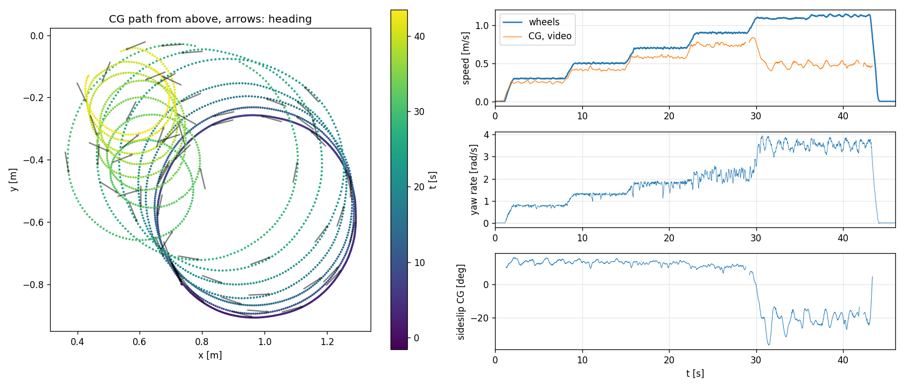
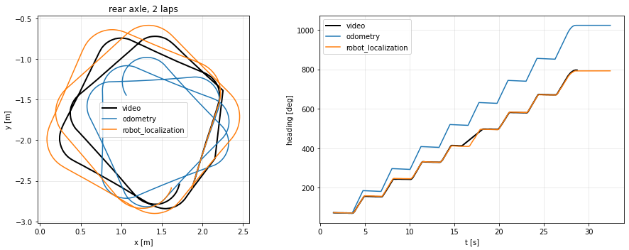
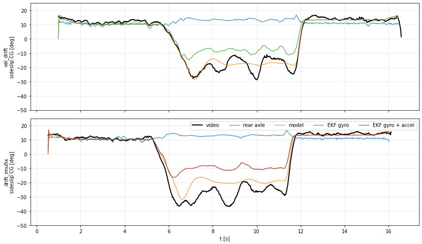
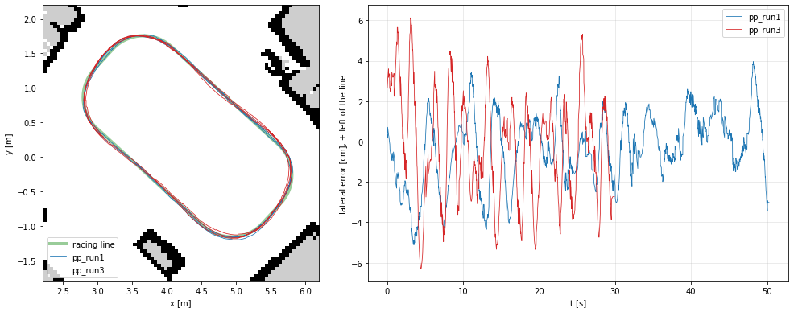
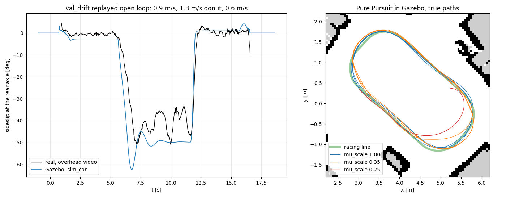
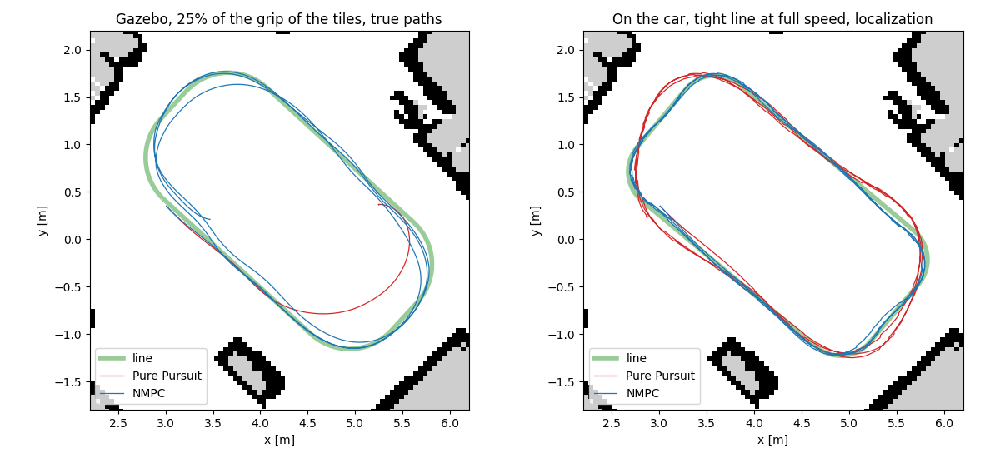
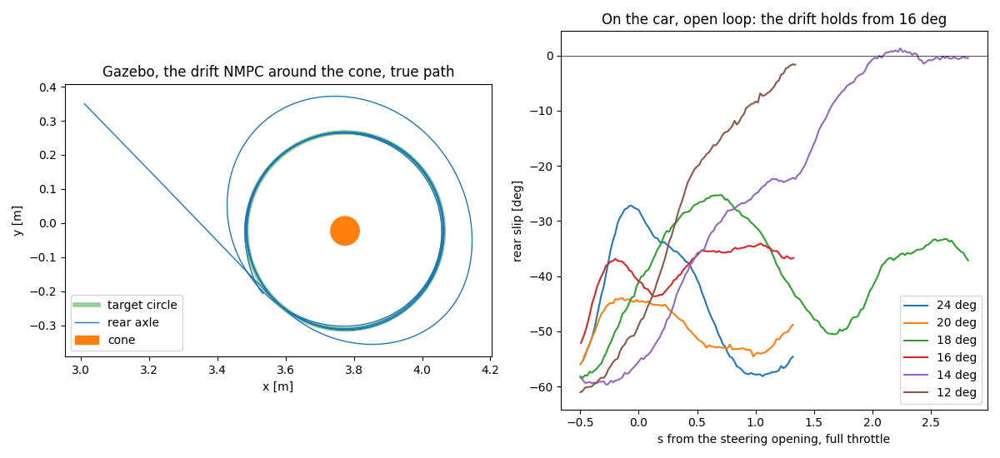
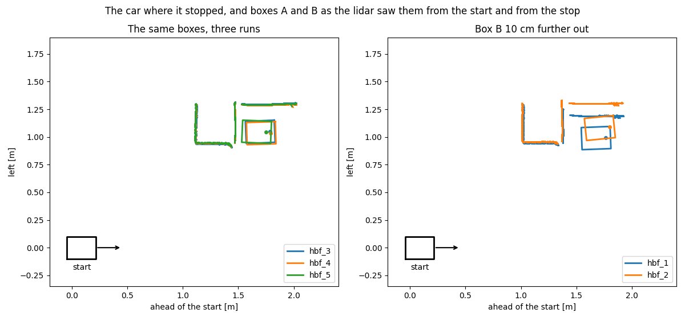
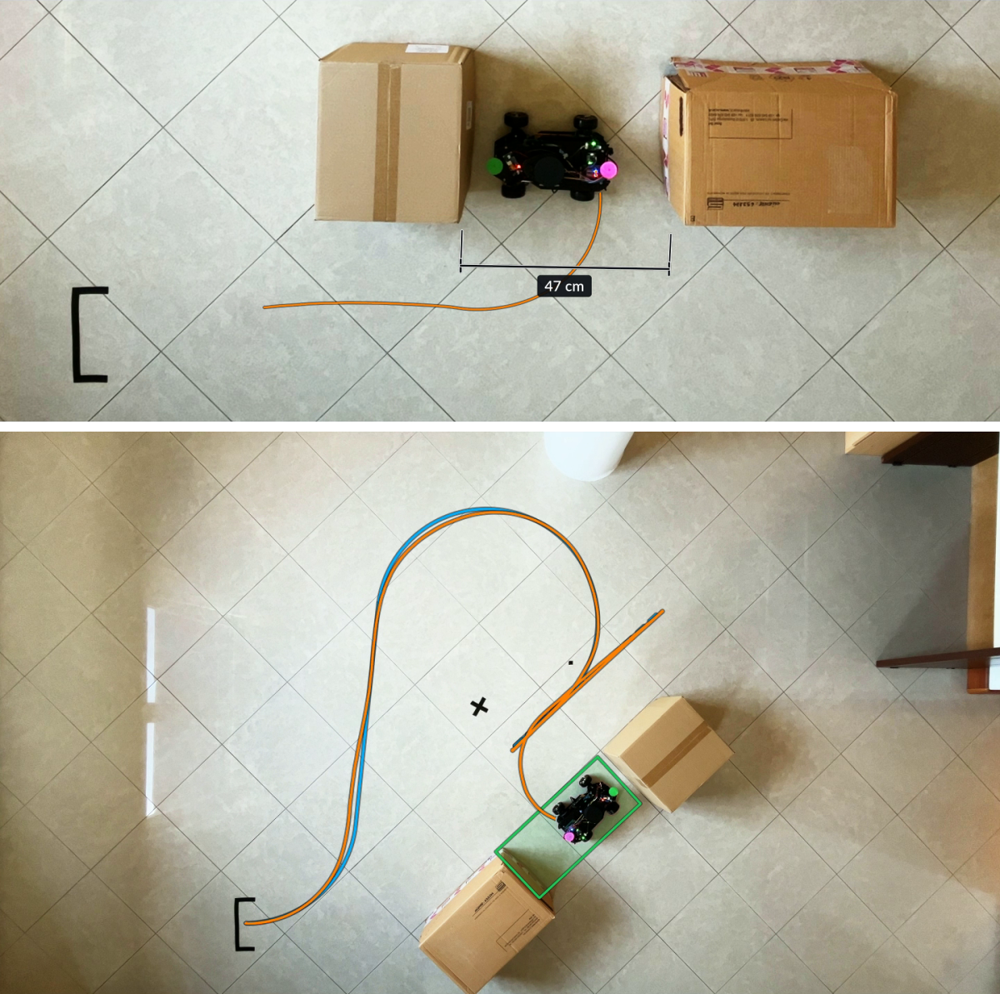

# Autonomous Drift Parking with Lidar and Nonlinear MPC on a 1:10 Ackermann Car

[](https://github.com/Gelminaio/drift-mpc-ackermann/actions)
[](https://opensource.org/licenses/MIT)
[](https://docs.ros.org/en/jazzy/)

A 1:10 car that finds a gap between two boxes with its lidar, drives to it with a **nonlinear MPC** running on its
Raspberry Pi, and **slides into it sideways**: a gap of 1.8 car lengths, on a tiled floor.

Technical report: [`report/report.pdf`](report/report.pdf) (6 pages, LaTeX source in [`report/`](report/)).

---

## Abstract

This project takes a 1:10 Ackermann car from an identified model to autonomous manoeuvres at the limit of grip. A
dynamic single-track model with saturating tires, identified from overhead video, IMU and encoders, carries a
nonlinear MPC (acados) that runs on the car's Raspberry Pi 4 at 50 Hz and holds a tight line where Pure Pursuit
cuts it. The drift was studied around a cone: in Gazebo a drift NMPC holds it and reads the friction of the floor
from its steering; on the car the drift does not hold, the rear grips again on any correction. The work moved to the
slide with the rear wheels locked, where the model holds: a handbrake turn steered in the slide, then a sideways
parking between two boxes found with the lidar, kicked where the stop leaves room at both ends and braked on the
gyro, down to a 47 cm gap for a 26 cm car. The boxes can be put anywhere: the car finds the gap among the points its
map does not have, plans the approach and drives it with the NMPC, backing up when it has to. The final
demonstration is a gymkhana in one take: an NMPC slalom round two cones, a donut, the way back and the drift
parking, ten clean takes. The whole stack runs on ROS 2 Jazzy across an ESP32 and the Pi, and unchanged in Gazebo.

---

## Vehicle Platform

<p align="center">
  
</p>

<table align="center">
  <tr>
    <td width="33%" align="center" valign="top">
      
      <br/><em>Side view</em>
      <br/><sub>Three-tier chassis hosting sensors, control electronics, and power distribution.</sub>
    </td>
    <td width="33%" align="center" valign="top">
      
      <br/><em>Top view</em>
      <br/><sub>Sensor and compute layout — RPLIDAR A1, BNO085 IMU, ESP32, XL4015 buck converter.</sub>
    </td>
    <td width="33%" align="center" valign="top">
      
      <br/><em>Electronics detail</em>
      <br/><sub>ESP32 microcontroller with BNO085 9-DoF IMU over I2C, alongside the RPLIDAR USB adapter and Raspberry Pi 4B host.</sub>
    </td>
  </tr>
</table>

---

## Architecture


Two computers on the car, a desktop for everything else:

- **ESP32 (real-time layer)** — FreeRTOS firmware running per-wheel velocity PID at 100 Hz, hardware quadrature encoder reading, BNO085 IMU acquisition, Ackermann servo control, and a safety supervisor (ARMED/DISARMED state machine, command-timeout soft-stop, per-wheel stall detection, hardware task watchdog). Exposes a micro-ROS node over USB serial publishing `/joint_states`, `/imu/data_raw` and `/steering_angle` at 50 Hz, subscribing to `/drive` (speed and steering angle), `/cmd_vel` and `/arm`. Speed 0 shorts the motor: the rear wheels lock.
- **Raspberry Pi 4 (on the car)** — lidar driver, micro-ROS agent, odometry, EKF and AMCL on the map, and the controllers: the NMPC at 50 Hz, the parking and the planner.
- **Desktop (Ubuntu 24.04)** — Gazebo simulation of the car and the room, model fitting and analysis, RViz.

---

## Hardware Bill of Materials

| Component | Model | Role | Approx. Cost (EUR) |
|---|---|---|---|
| SBC | Raspberry Pi 4B (4GB) | Localization, controllers, ROS 2 networking | 100 |
| Power supply (RPi) | USB-C Powerbank | RPi mobile power | 20 |
| MCU (real-time control) | ESP32-WROOM-32 | Motor PID, encoders, IMU, servo | 8 |
| IMU | Bosch BNO085 | 9-DoF with onboard sensor fusion | 36 |
| LIDAR | Slamtec RPLIDAR A1 | 2D 360° laser scan, 6.8 Hz | 110 |
| Camera | Raspberry Pi Camera Module 3 Wide | Onboard view, not used by the controllers | 38 |
| Motor drivers (×2) | BTS7960 (Half-bridge) | DC motor power stage | 17.5 |
| Step-down converters (×5 pack) | XL4015 | 11.1V → 6V (servo rail) and auxiliary rails | 16 |
| Chassis kit (1:10 RC) | Custom assembly | Mechanical base + 2× geared motors w/ quadrature encoders + LD-1501MG steering servo + 3S LiPo 11.1V 6000 mAh battery | 140 (~100 USD + shipping & customs) |
| Drift tires | Hard plastic RC drift tires (and a PVC panel, too small to use) | Low grip on the tiles | ~25 |
| **Total** | | | **~510** |

---

## Software Stack

| Layer | Technology |
|---|---|
| Real-time firmware | C++ / Arduino-ESP32 / FreeRTOS, micro-ROS |
| Middleware | ROS 2 Jazzy Jalisco |
| Perception | `rplidar_ros`; boxes, gaps and cones from the scans |
| State estimation | `robot_localization` (EKF), `slam_toolbox` maps, AMCL; sideslip from the identified model |
| Control | Nonlinear MPC via [`acados`](https://docs.acados.org/) on the identified dynamic model; Pure Pursuit as the baseline |
| Parking | Lidar gap, arc-straight-arc approach, kick and gyro-timed brake |
| Simulation | Gazebo Harmonic (`ros_gz`), identified dynamics in a C++ system plugin, adjustable friction |
| Tooling | PlatformIO, colcon, GitHub Actions |

---

## Repository Structure

```
drift-mpc-ackermann/
├── firmware/           # ESP32 firmware (PlatformIO)
├── ros2_ws/src/        # ROS 2 packages: description, odometry, control, nmpc, bringup, gazebo
├── setup/pi/           # Raspberry Pi: micro-ROS agent service, udev rule, ROS environment
├── docs/               # Technical notes
├── report/             # Technical report: LaTeX source and PDF
├── notebooks/          # Identification, estimation, control and parking analysis
├── scripts/            # Track, paths, test and analysis utilities
├── media/              # Diagrams, photos, figures
└── README.md
```

---

## Getting Started

### Prerequisites

- Ubuntu 24.04 LTS, ROS 2 Jazzy Jalisco (desktop and Pi)
- PlatformIO (firmware)
- acados v0.6.0, see [`docs/nmpc.md`](docs/nmpc.md)
- Gazebo Harmonic for the simulation, see [`docs/simulation.md`](docs/simulation.md)

### Quick Start

```bash
# Clone
git clone https://github.com/Gelminaio/drift-mpc-ackermann.git
cd drift-mpc-ackermann

# Flash firmware (ESP32 connected via USB)
cd firmware && pio run -e esp32dev --target upload

# On the car (Raspberry Pi): sensors, odometry and TF; localization on a map
ros2 launch ackermann_bringup robot.launch.py
ros2 launch ackermann_bringup localization.launch.py map:=room2

# The gymkhana, from its start mark; or the parking from wherever the boxes are
ros2 launch ackermann_bringup gymkhana.launch.py layout:=room2
ros2 launch ackermann_bringup valet.launch.py map:=room2
```

The micro-ROS agent runs as a systemd service on the Pi, see [`setup/pi/`](setup/pi/). The same launch files run in
Gazebo with `use_sim_time:=true`, see [`docs/simulation.md`](docs/simulation.md).

---

## Project Roadmap

The project is structured in 12 incremental phases, from the hardware to the final demonstration and report:

- [x] **Phase 1** — Hardware assembly & electrical integration
- [x] **Phase 2** — Infrastructure & repository setup
- [x] **Phase 3** — ESP32 firmware: motor drivers, PID, IMU, micro-ROS
- [x] **Phase 4** — ROS 2 bridge & sensor pipelines
- [x] **Phase 5** — Dynamic modeling & system identification (nonlinear tire model)
- [x] **Phase 6** — State estimation (EKF) & sideslip estimation
- [x] **Phase 7** — Track, racing line & baseline controller
- [x] **Phase 8** — Simulation in Gazebo: the identified model, the same stack, friction as a parameter
- [x] **Phase 9** — Nonlinear MPC at the limit of adhesion (acados), on the Pi
- [x] **Phase 10** — Drift around a cone: drift NMPC and friction from the drift in Gazebo; on the car the drift does not hold
- [x] **Phase 11** — Handbrake parking between two boxes, steered in the slide
- [x] **Phase 12** — Sideways gap parking, parking anywhere, the one-take gymkhana; video and report

Track progress via [GitHub Milestones](../../milestones).

---

## Results

### Phases 3-4 — Firmware and ROS 2 bridge

- Wheel speed PID on the ESP32 at 100 Hz, gains tuned by hand on step responses:
  [`notebooks/pid_tuning.ipynb`](notebooks/pid_tuning.ipynb).
- The car on battery, driven over Wi-Fi with RViz live: /odom 49 Hz, /scan 7.1 Hz. Wi-Fi cut at 0.5 m/s: it stops
  by itself in 0.34 m, the 500 ms command timeout plus the soft-stop ramp. [`docs/phase4_demo.md`](docs/phase4_demo.md).
- Bags extracted to parquet on the Pi ([`scripts/bag_extract.py`](scripts/bag_extract.py)) and checked across sensors:
  the IMU's lateral acceleration against v·ω from the odometry, [`notebooks/pipeline_test.ipynb`](notebooks/pipeline_test.ipynb).

### Phase 5 — System identification

<p align="center">
  
</p>

Hard plastic drift tires on tiles. Full left lock, wheel speed stepped up until the rear lets
go (30 s): steady drift at 3.5 rad/s, CG sideslip -20 deg. Ground truth from an
overhead phone video tracking two markers on the car, plus IMU and encoders.

- Dynamic single-track model, spool rear axle (two slipping wheels), saturating tires.
  Fitted on identification runs; 1 s ahead on validation runs: yaw rate NRMSE 11-17%,
  sideslip error 1.4-1.6 deg in grip and 3.1-3.9 deg in the drift.
- Rear friction at full slide 0.276 from the fit, 0.248 from straight launches with wheelspin.
- Steering lag 0.17 s from command to yaw response, against 25-40 ms for the servo alone.
- Every parameter with its uncertainty and source:
  [`vehicle_params.yaml`](ros2_ws/src/ackermann_description/config/vehicle_params.yaml).
  Analysis in [`notebooks/`](notebooks/).

### Phase 6 — State estimation

<p align="center">
  
  
</p>

- ESP32 clock synced to the Pi: IMU and encoder stamps arrive 7 ms old, steady.
- The accelerometer was a stale copy of itself (60% repeated samples, up to 1.3 s): the
  firmware read one IMU packet per poll. Fixed; its means now match the video within 0.1-0.3 m/s².
- robot_localization with wheel speed and gyro, 2 laps of a 1.6 m square: heading within
  5 deg and position within 0.2 m. Odometry alone ends 227 deg off (spool, tight turns).
- Sideslip: the identified model driven by wheel speed and steering is within 1-2 deg of the
  video in grip, 4-9 deg in a drift. The IMU cannot improve it there: once the tires slide,
  yaw rate and acceleration barely change with sideslip. Lidar velocity comes in Phase 7.
- [`notebooks/state_estimation.ipynb`](notebooks/state_estimation.ipynb).

### Phase 7 — Track and baseline controller

<p align="center">
  
</p>

- Map of the room with slam_toolbox, localization with AMCL on top of the EKF, on the Pi.
- Racing line: the largest rounded rectangle 0.5 m clear of every wall, 8.8 m, 0.77-1.0 m/s
  from a lateral limit of 1.0 m/s² (no drift).
- Pure Pursuit, lookahead picked on the Phase 5 model with a delayed pose: 3 laps at full
  speed, 10.1 s a lap, 2.7 cm rms from the line, 6-7 cm at worst.
- [`notebooks/track_following.ipynb`](notebooks/track_following.ipynb), [`docs/mapping.md`](docs/mapping.md),
  [`docs/localization.md`](docs/localization.md), [`docs/track.md`](docs/track.md).

### Phase 8 — Simulation in Gazebo

<p align="center">
  
</p>

- Gazebo Harmonic: the room built from the map, the lidar as the A1, and a C++ system plugin in
  place of the ESP32 and the car: same ROS topics, Phase 5 dynamics at 1 kHz, measured IMU noise.
- The Phase 7 stack runs unchanged on sim time: 10.1 s laps as the real car, localization 6 cm
  rms from the truth, 4.4 cm from the line against 2.7 (the model turns 4-6% less in corners).
- The drift replayed open loop: the same donut, 6-9 deg more sideslip at the rear axle (the
  model has no motor torque limit).
- Floor friction as a parameter: Pure Pursuit tuned on the tiles holds the line down to 35% of
  their friction and spins at 25%.
- [`notebooks/simulation.ipynb`](notebooks/simulation.ipynb), [`docs/simulation.md`](docs/simulation.md).

### Phase 9 — Nonlinear MPC at the limit

<p align="center">
  
</p>

- acados on the Phase 5 model in CasADi, path coordinates of the rear axle, one Gauss-Newton SQP
  iteration with a line search every 20 ms. The C++ node solves in 8 ms on the Pi.
- Gazebo, friction as a parameter: at 35% of the grip of the tiles 3.3 cm rms from the line
  against 7.6 for Pure Pursuit; at 25% Pure Pursuit spins in the first lap, the NMPC drives three
  laps 6.7 cm rms from the line, 10% slower.
- On the car, tight line (0.4 m corners) at full speed: 2.7 cm rms from the line (7.4 at worst)
  against 7.1 (19.4), 21% slower. On the Phase 7 line the two are even, 3.5 against 3.4 cm: there
  the localization sets the error.
- [`notebooks/nmpc.ipynb`](notebooks/nmpc.ipynb), [`docs/nmpc.md`](docs/nmpc.md).

### Phase 10 — Drift around a cone

<p align="center">
  
</p>

- The drift NMPC on a circle around a cone, the cone as the reference in the lidar scan. Gazebo:
  the rear axle 28.8 +- 0.1 cm from the cone against 28.9, within 1.1 cm with the scan 0.15 s late.
- Friction from the drift: on the circle the state is known and the model has one steady state per
  friction. Five floors in Gazebo, estimates within 0.6%.
- On the car the drift does not hold. The rear lets go only on a torque step, and open loop the car
  keeps sliding only from 16 deg of steering, on a 0.19 m circle; any correction grips it again
  within 0.5 s. The drift of the simulator (13-14 deg, 0.28 m) is the unstable middle steady state
  of the model. Phase 11 moves to the slide with the rear wheels locked.
- [`notebooks/drift.ipynb`](notebooks/drift.ipynb), [`docs/nmpc.md`](docs/nmpc.md).

### Phase 11 — Handbrake parking

<p align="center">
  
</p>

- A handbrake turn: straight, a turn, then speed 0 and the motor driver locks the rear wheels. In the
  slide the model, run to the stop every 20 ms, picks the steering that stops the car at the heading
  asked; a locked rear slides with 1.5 times the friction of a spinning one. With the same commands
  open loop the car stopped anywhere from 177 to 197 deg; steered, 181.6 +- 2.2 deg over 28 runs.
- The boxes from the lidar: the corner of box A sets where the car turns, box B how far out, through
  the steering of the turn. Box A 19 cm further, the stop 22 cm further; box B 10 cm further out, the
  stop 9.6 cm further out.
- The turn in grip, the straight held on the line of the start: the same boxes, the stops within 4 cm
  along the path and 1.3 cm across. At full lock and full throttle the floor decides when the rear lets
  go and the stops spread 20 cm across.
- [`notebooks/handbrake.ipynb`](notebooks/handbrake.ipynb), [`notebooks/parking.ipynb`](notebooks/parking.ipynb), [`docs/nmpc.md`](docs/nmpc.md).

### Phase 12 — Gap parking, parking anywhere, gymkhana

<p align="center">
  
</p>

- Sideways into a gap between two boxes, from rest: the lidar gives the gap, the car holds its line at
  0.4 m/s, kicks at full lock and full throttle where the stop leaves as much room at the nose as beyond
  the swept tail, drifts round at 3.4-4.0 rad/s and brakes on the gyro so that the slide after the brake
  ends at 180 deg. 180.8 +- 2.9 deg over nine runs; down to 47 cm by the tape, 1.8 car lengths, the body
  at least 2.2 cm from one box and 4.4 from the other. The slide after the brake, 29-43 deg with the floor,
  sets the spread.
- The brake acted 10-41 ms after the command: the ESP32 took `/drive` every 20 ms, one message per pass.
  Every 5 ms, 10 +- 3 ms.
- Parking anywhere: two boxes put down by hand, the car finds them among the points its map does not
  have, plans an arc-straight-arc approach 5 cm clear of everything (backing up along the boxes when that
  is shorter) and drives it with the NMPC. 11 runs at 6 places: 1.4-4.8 cm rms from the plan, one touch.
- The gymkhana in one take: NMPC slalom round two cones, a donut braked on the gyro, the way back, the
  gap parking. Ten takes on the shoot day, 29-35 s each: the lap 3.3-5.6 cm rms from its path, the
  cones at least 8 cm from the body, parked at 179.3-182.3 deg at least 5.4 cm from both boxes.
- [`notebooks/sideways.ipynb`](notebooks/sideways.ipynb), [`notebooks/park_anywhere.ipynb`](notebooks/park_anywhere.ipynb),
  [`notebooks/gymkhana.ipynb`](notebooks/gymkhana.ipynb), [`docs/nmpc.md`](docs/nmpc.md).

---

## Citation

If you use this work, please cite:

```bibtex
@misc{gelmini2026driftparking,
    title  = {Autonomous Drift Parking with Lidar and Nonlinear MPC on a 1:10 Ackermann Car},
    author = {Gelmini, Pietro},
    year   = {2026},
    note   = {Technical report},
    url    = {https://github.com/Gelminaio/drift-mpc-ackermann}
}
```

---

## License

This project is released under the [MIT License](LICENSE).

---

## Contact

**Pietro Gelmini** — [gelmini.pietro@gmail.com](mailto:gelmini.pietro@gmail.com)
LinkedIn: [https://www.linkedin.com/in/pietro-gelmini/](https://www.linkedin.com/in/pietro-gelmini/)
